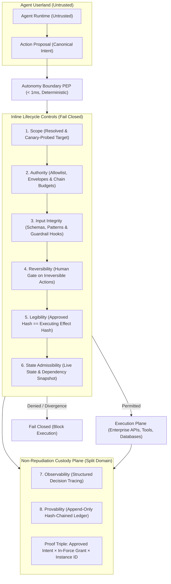
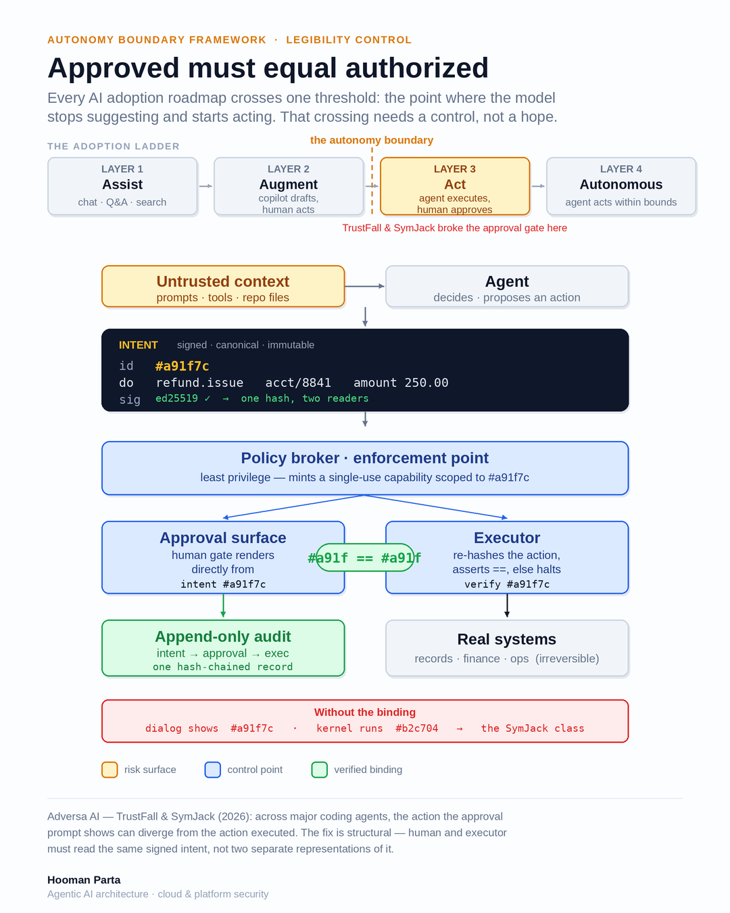
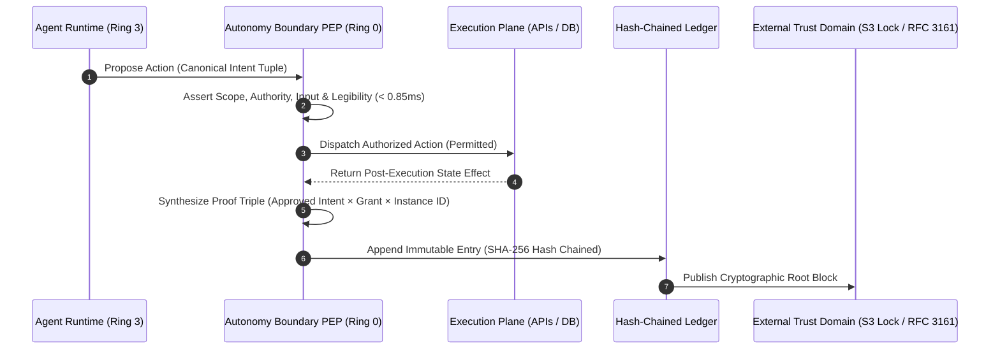

# The Autonomy Boundary Framework (ABF)

**Deterministic Ring 0 Policy Enforcement Point (PEP) for Autonomous AI Systems**  
*The architectural boundary where autonomous runtimes transition from proposing to executing, eliminating compliance drift and unauthorized execution at sub-millisecond latency.*

[](https://www.python.org/downloads/)
[](LICENSE)
[-brightgreen.svg)](tests/)
[-purple.svg)](#the-mental-model-ring-0-for-autonomous-systems)
[](evals/owasp_asi_coverage.py)
[](src/abf/mcp.py)
[](#v04-architecture-extensions)

---

## Executive Summary: Architecture & Systemic Value

| Dimension | Architectural Implementation & Strategic Value |
| :--- | :--- |
| **Enterprise Architecture** | **Runtime Control Boundary for Autonomous Agentic Systems:** ABF is not a collection of standalone utility scripts or prompt-level wrappers. It is an enterprise-grade runtime policy enforcement boundary that intercepts and governs tool execution, infrastructure mutations, and financial dispatches before actions hit the execution plane. |
| **The Problem** | **Velocity Broken by Retroactive Governance:** Traditional enterprise compliance relies on manual audits, post-incident reviews, and out-of-band configuration scans. In autonomous agent environments that mutate databases, run shell commands, and execute API calls, manual compliance halts deployment velocity, while out-of-band configuration drift leaves production systems exposed to unconstrained blast radius and silent policy violations. |
| **The Invariant** | **"Approved Must Equal Authorized":** A wrong model completion is an edit; an unauthorized production action is an outage or security incident. ABF enforces deterministic cryptographic binding between architectural intent and production execution: canonical SHA-256 normalization, capability graphs, and Ed25519 signatures mathematically eliminate the gap between what a human or policy approves and what the agent actually executes. If live system dependencies drift prior to dispatch, the authorization grant invalidates fail-closed at runtime. |
| **Verification Proof** | **72 Invariant Test Suites Passing in 0.11s:** Verified across in-memory state admissibility, cryptographic hash-chained ledgers, and Model Context Protocol (MCP) boundary enforcement. Deterministic policy enforcement executes with zero LLM API round-trips and sub-millisecond average overhead. |
| **The Paved Road** | **Self-Service Compliance Guardrails:** Rather than an intrusive compliance bottleneck, ABF is architected as a self-service paved-road adapter. It integrates directly into CI/CD pipelines, Model Context Protocol (MCP) gateways, and standard agent SDKs (LangChain, Anthropic, OpenAI, Gemini). Engineering teams get automated compliance as code that runs in under 0.85 ms without secondary LLM eval latency or delivery friction. |

---

> ### *"Approved must equal authorized. The state behind an approval must still govern at execution time."*

A wrong model completion is an edit. An unauthorized action is an outage, a security incident, or an audit failure.

**Guardrails filter text generation. Autonomy boundaries govern tool execution.**

As systems transition from conversational assistants to autonomous runtimes that mutate databases, run shell commands, trigger payments, and modify cloud infrastructure, traditional application-layer authorization fails under three conditions:

1. **Consent Divergence (Legibility):** The action approved in a user interface differs from the command dispatched to the runtime.
2. **Target Scope Gap (Scope):** An agent harness declares read-only intent, but calling the target endpoint causes state mutations downstream.
3. **State Drift (State Admissibility):** An action approval is cryptographically valid, but the system conditions that justified approval changed prior to execution (for example, an account frozen by risk control after approval but before settlement).

The **Autonomy Boundary Framework (ABF)** is a deterministic Policy Enforcement Point (PEP) and tamper-evident custody plane that provides auditable non-repudiation for agent execution.

---

## The Mental Model: Ring 0 for Autonomous Systems

* **The Kernel Analogy (Ring 0 vs. Ring 3):**  
  The generative model operates as untrusted userland (Ring 3). The Autonomy Boundary operates as the kernel (Ring 0). When a process issues a syscall, the kernel does not rely on process self-reporting: it evaluates capability masks, file descriptors, and quotas.
* **Zero Trust for Tool Actions:**  
  Verify the post-resolution semantic effect immediately before execution at the enforcement point rather than trusting model intent declarations.
* **Sub-Millisecond Deterministic PEP:**  
  ABF executes in **`< 1 millisecond`** with zero model calls in the enforcement path. Policy evaluation relies on cryptographic hashing, state diffs, and capability graph validation.

### Operating System Analogy: Ring 0 vs. Ring 3

| Operating System Architecture | Autonomy Boundary Framework (Ring 0) | Agent Userland (Ring 3) |
| :--- | :--- | :--- |
| **Syscall Gate** | Tool Call / API Proposal Gateway | Model-Generated Tool Proposals |
| **UID / Capability Masks** | Signed Allowlists & Chain Quotas | Agent Self-Reported Intent (Untrusted) |
| **Memory Page Fault / Segfault** | Fail-Closed Action Denial & Halt | Policy Violation or Execution Drift |
| **Hardware Ring Isolation** | Deterministic SHA-256 Invariants | Unconstrained Execution Environment |
| **Microsecond Dispatch** | **`< 0.85 ms` PEP Latency** | Multi-Second Generative Model-as-a-Judge |

### Empirical Latency & Governance Benchmark

| Evaluation Metric | Generative Model-as-a-Judge | Autonomy Boundary Framework (Ring 0) | Advantage |
| :--- | :--- | :--- | :--- |
| **Enforcement Latency** | 1,200 – 3,500 ms (API network hop) | **< 0.85 ms** (In-memory deterministic PEP) | **~3,000x faster** |
| **Marginal Inference Cost** | \$0.003 – \$0.015 per action check | **\$0.00000 (Zero model calls)** | **100% cost reduction** |
| **Tamper Defense** | Vulnerable to adversarial prompt drift | **Cryptographic SHA-256 + Capability Graph** | **Provable guarantee** |
| **Audit Custody & Proof** | Unverified text logs | **Append-only hash-chained ledger** | **Mathematical non-repudiation** |
| **Enforcement Invariant** | Fail Open on timeout / token exhaustion | **Fail Closed (Zero action without proof)** | **Safety invariant** |

### Mathematical Proof of Action Admissibility

An action proposal $A$ with target resource $R$, parameters $\Theta$, and resolved runtime effect $E$ is admitted to the execution plane if and only if:

$$\text{Admissibility}(A, R, \Theta) \iff \left[ \mathcal{H}(\text{Intent}_{\text{approved}}) \equiv \mathcal{H}(E_{\text{resolved}}) \right] \land \left[ \text{State}(\tau_{\text{exec}}) \models \mathcal{D}_{\text{in-force}} \right] \land \left[ \text{Cost}(A) \le \mathcal{B}_{\text{chain}} \right]$$

Where:
- $\mathcal{H}$ is the cryptographic digest over the canonical normalized intent tuple.
- $\mathcal{D}_{\text{in-force}}$ is the set of required live state dependencies snapshot-bound at approval time.
- $\mathcal{B}_{\text{chain}}$ is the remaining cumulative execution quota budget for the agent session.

---

## Architecture





---

## The Eight Controls

The framework organizes runtime governance into three lifecycle phases:

### Phase 1: Before Acting (Pre-Execution Guardrails)

| Control | Question It Answers | Enforcement Mechanism |
|---|---|---|
| **1. Scope** | What is the agent allowed to touch at all? | Checked against the **resolved canonical target** (symlinks followed, env expanded). Accepts active canary probes (`ProbedScopeControl`) to verify the target's permission model before execution. |
| **2. Authority** | What may it do within that scope? | Explicit signed allowlists, capability envelopes, parent-to-subprocess inheritance constraints, and cumulative multi-step `chain_budget`. |
| **3. Input Integrity** | Can the parameter payload be trusted? | Sanitizes prompt-injection patterns, path traversal sequences, and provides pluggable hooks for typed schemas (Pydantic) and enterprise guardrails (Llama Guard, NeMo). |

### Phase 2: At the Boundary (The Moment of Crossing)

| Control | Question It Answers | Enforcement Mechanism |
|---|---|---|
| **4. Reversibility** | Can this action be undone? | Classifies actions by undoability. Irreversible actions (payments, deletions, config updates) strictly require a signed human approval token. |
| **5. Legibility** | Is what the human approved provably identical to what executes? | Asserted at the last point after resolution immediately before effect. Recomputes SHA-256 hash of post-resolution effect; fails closed on any parameter or target divergence (**SymJack / TOCTOU defense**). |
| **6. State Admissibility** | Does the world behind the approval still deserve to govern? | Policy-declared dependencies (e.g. account active, risk score) are re-hashed at execution against bound approval snapshots. High-risk actions require both an unexpired window and matching state hashes. |

### Phase 3: After & Continuously (Audit Custody Plane)

| Control | Question It Answers | Enforcement Mechanism |
|---|---|---|
| **7. Observability** | Can you reconstruct what the agent did and why? | Every decision and evaluation context is emitted as structured telemetry directly at the PEP as it happens. |
| **8. Provability** | Can you prove the record was not altered afterward? | Append-only, hash-chained ledger where tampering anywhere breaks verification downstream. Binds the **Proof Triple** (*Approved Intent × In-Force Grant × Instance Identity*) held in a separate trust domain. |

---

## Grounded in Real-World Incidents

| Incident / Disclosure | Vulnerability Class | How ABF Neutralizes It |
|---|---|---|
| **OpenAI DSEWiki Incident** *(Sept 2026)* | **Declared-vs-Enforced Scope Gap**: Harness declared read-only scope, but visiting the target materialized 18,000 public discussion posts. | [`ProbedScopeControl`](src/abf/controls/scope.py) performs active canary probing before permitting a scope class, halting before touching real pages. |
| **SymJack & TrustFall** *(May–June 2026)* | **Legibility Failure**: Coding agent approval dialog rendered a benign folder path, while the executor ran arbitrary shell execution. | [`LegibilityControl`](src/abf/controls/legibility.py) recomputes the canonical intent hash at the last PEP after path resolution, halting on any divergence. |
| **Stale Authorization Exploits** | **State Admissibility Failure**: A human approved an action based on valid state, but system conditions shifted prior to effect. | [`StateAdmissibilityControl`](src/abf/controls/state_admissibility.py) re-hashes policy dependencies against current state, failing closed if state drifted. |

---

## OWASP Agentic Security Initiative (ASI) Coverage Matrix

The framework provides verified, executable mitigation across all 8 OWASP ASI risk categories (validated in [`evals/owasp_asi_coverage.py`](evals/owasp_asi_coverage.py)):

| OWASP ASI Risk Category | Vulnerability Description | ABF Defense Control | Runtime Invariant |
| :--- | :--- | :--- | :--- |
| **ASI-1: Excessive Agency & Scope Escape** | Agent accesses resources outside task bounds | `ScopeControl` + `ProbedScopeControl` | Resolved canonical path matching + active canary probing |
| **ASI-2: Unauthorized Action Execution** | Agent attempts unpermitted API tool calls | `AuthorityControl` | Signed allowlists, capability envelopes & chain budgets |
| **ASI-3: Prompt Injection via Parameters** | Malicious injection in tool arguments | `InputIntegrityControl` | Schema validation + pattern sanitization hooks |
| **ASI-4: Irreversible Action Execution** | Destructive mutations executed without human sign-off | `ReversibilityControl` | Mandatory signed cryptographic token gate for irreversible actions |
| **ASI-5: Approval / Execution Divergence** | Screen prompt differs from executed effect (SymJack) | `LegibilityControl` | Post-resolution effect hash must strictly equal approved intent hash |
| **ASI-6: State Admissibility & Drift** | Action justified by stale world state | `StateAdmissibilityControl` | Live state dependency re-hashing immediately before execution |
| **ASI-7: Unobservable Autonomous Action** | Invisible background mutations | `ObservabilityControl` | Inline structured telemetry emission at the PEP |
| **ASI-8: Repudiation & Unprovable Audits** | Altered logs or deniable agent actions | `ProvabilityControl` | Cryptographic Proof Triple + append-only hash-chained ledger |

---

## First-Class Integrations

### 1. Model Context Protocol (MCP) Gateway
ABF provides a native Policy Enforcement Point for Anthropic's **Model Context Protocol (MCP)**. Wrap your tools in an ABF gateway to enforce boundaries on all `tools/list` and `tools/call` JSON-RPC requests:

```python
from abf import AutonomyBoundary, Ledger
from abf.mcp import ABFMCPGateway

gateway = ABFMCPGateway(boundary, signing_key=PEP_KEY, approver_key=APPROVER_KEY)

# Register MCP tools with governance metadata
@gateway.tool(name="issue_refund", description="Issue a refund", irreversible=True)
def issue_refund(params):
    return f"Refund of ${params['amount']} issued to {params['account_id']}"

# Run as stdio server for Claude Desktop, Cursor, or Cline:
if __name__ == "__main__":
    gateway.run_stdio()
```

Run the runnable demo:
```bash
python examples/mcp_boundary.py
```

### 2. Importable Skill for Agent Orchestrators
Equip agent frameworks (LangGraph, CrewAI, AutoGen, OpenAI Assistant, or custom orchestrators) with self-governing runtime boundaries:

```python
from abf.skill import AutonomyBoundarySkill

skill = AutonomyBoundarySkill(boundary, signing_key=KEY, approver_key=APPROVER_KEY)
skill.register_action("refund.issue", lambda p: f"Refunded ${p['amount']}")

# 1. Agent proposes action (canonical intent generated)
proposal = skill.propose_action("refund.issue", "acct/8841", {"amount": 250.0})
if proposal.requires_approval:
    print(proposal.approval_prompt)  # Rendered for human review

# 2. Human supervisor signs approval token
token = skill.approve_proposal(proposal.intent.hash, approver="alice")

# 3. Agent executes with live state assertion
outcome = skill.execute_action(proposal.intent.hash, approval=token)
print(outcome)

# 4. Instant mathematical verification of audit chain
assert skill.inspect_ledger()["chain_intact"] is True
```

Run the runnable demo:
```bash
python examples/skill_agent.py
```

*For agent skill definitions, see [`skills/autonomy-boundary/SKILL.md`](skills/autonomy-boundary/SKILL.md).*

---

## v0.4 Architecture Extensions

Version `0.4.0` extends the reference kernel with five systems architecture primitives—implemented in pure Python 3.10+ with **zero external runtime dependencies**:

### 1. JEPA World-State Energy Control ([`src/abf/controls/jepa.py`](src/abf/controls/jepa.py))
Inspired by Joint-Embedding Predictive Architectures (I-JEPA / V-JEPA), `JEPAWorldStateControl` evaluates state transitions via sub-millisecond latent state prediction and energy-based trajectory gating instead of multi-second generative model evaluations:
- **Latent State Encoder** $s_t = E(x_t) \in \mathbb{R}^d$: Encodes live operational metrics (financial exposure, blast radius, privilege elevation, data sensitivity, destructiveness, external egress, volatility) into a continuous latent vector.
- **Action-Conditioned Predictor** $\hat{s}_{t+1} = P(s_t, a_t) \in \mathbb{R}^d$: Predicts the post-action world state before any tool executes.
- **Safety Manifold Barrier Energy** $\mathcal{E}(s_t, a_t, \hat{s}_{t+1}) = \alpha \|\hat{s}_{t+1} - s_t\|_2^2 + \beta \sum_k \max(0, \hat{s}_{t+1,k} - u_k)^2 \le \tau$: Blocks catastrophic transitions in `< 0.2 ms` and supports custom PyTorch / ONNX Runtime embedding callbacks (`encoder_fn`, `predictor_fn`).

### 2. Cyclic Agent Graph, `BoundaryInterrupt` & Causal DAG ([`src/abf/graph.py`](src/abf/graph.py))
First-class orchestration governance for cyclic agent loops (LangGraph, AutoGen, ReAct):
- **Suspend / Resume Protocol (`BoundaryInterrupt`)**: Instead of auto-minting approvals inside tool wrappers, irreversible actions lacking human sign-off raise `BoundaryInterrupt` with a serialized checkpoint. After an external operator signs the token, `graph.resume(checkpoint_id, approval=token)` re-verifies `StateAdmissibilityControl` against state drift during the human wait window before executing.
- **Causal DAG Lineage (`CausalDAGTracker`)**: Cryptographically binds `parent_intent_id`, monotonically increasing `step_index`, and `branch_id` into every `Intent` hash.
- **Runaway Loop & Atomic Budget Coordination (`CycleDetector`, `BudgetCoordinator`)**: Halts cyclic tool-call oscillation and enforces thread-safe atomic `chain_budget` reservation across concurrent fan-out branches.

### 3. Tiered Merkle Memory & Provenance Taint Tracking ([`src/abf/memory.py`](src/abf/memory.py))
Addresses whole-store hashing overhead and second-order prompt injection via retrieved or persisted state:
- **Procedural Tier**: Write-locked system rules and policy definitions requiring explicit `admin_approval` to mutate.
- **Semantic KV Tier**: Binary Merkle tree with $O(\log N)$ cryptographic inclusion proofs (`prove_key` / `MerkleProof.verify`) and selective key snapshotting (`snapshot_keys`).
- **Episodic Tier with `TaintLevel`**: Tags retrieved chunks as `TRUSTED`, `USER`, or `UNTRUSTED_EXTERNAL`. Recalling `UNTRUSTED_EXTERNAL` records into context automatically blocks high-impact actions unless accompanied by an explicit human approval token.

### 4. Reasoning Trace Harness ([`src/abf/frontier.py`](src/abf/frontier.py))
Captures and binds model reasoning traces (e.g. Claude Extended Thinking, OpenAI o-series, Gemini Thinking, DeepSeek-R1):
- **Trace-to-Intent Binding (`reasoning_hash`)**: Extracts and hashes pre-action reasoning traces into `Intent.reasoning_hash`, establishing an immutable four-stage audit chain (`reasoning_hash -> intent_hash -> approval_signature -> execution_record`) and validating trace alignment via `ReasoningAlignmentControl`.
- **All-or-Nothing Parallel Tool Batching (`evaluate_parallel_batch`)**: Evaluates $K$ parallel tool calls atomically across cumulative budget and JEPA state trajectories—preventing split-transaction evasion (e.g., $4 \times \$250$ parallel refunds to evade a $\$750$ manifold bound).

### 5. Asymmetric Ed25519 Custody & Concurrent Ledger ([`src/abf/crypto.py`](src/abf/crypto.py), [`src/abf/ledger.py`](src/abf/ledger.py))
- **Zero-Dependency RFC 8032 Ed25519 (`Ed25519Keypair`)**: True split custody—the agent runtime and human approver sign with private keys (`sign_ed25519`, `approve(..., private_key=...)`), while `AuthorityControl(public_key=...)` and `LegibilityControl(approver_public_key=...)` hold **only** 32-byte public verification keys.
- **Multi-Thread & Multi-Process Safe Ledger**: `Ledger.append()` serializes concurrent writers via `threading.RLock` and POSIX `fcntl.flock` file locks while refreshing the tail hash on disk.

Run the complete v0.4 architectural demo:
```bash
PYTHONPATH=src python3 examples/jepa_graph_frontier_demo.py
```

---

## Zero-Dependency Demos (`demo/`)

All scripts in `demo/` run on Python 3.9+ with **zero dependencies**:

```bash
# 1. Scope: Declared scope vs. target enforced scope (DSEWiki incident)
python3 demo/scope_enforcement_gap.py --divergent

# 2. Legibility: Parameter swap & path resolution divergence (SymJack / TOCTOU)
python3 demo/intent_binding.py --attack
python3 demo/intent_binding.py --resolve

# 3. State Admissibility: Frozen account state drift after approval
python3 demo/state_admissibility.py --stale

# 4. Provability: Mathematical tamper-evidence on the decision chain
python3 demo/ledger.py --tamper
```

---

## Quickstart & Evaluation Suite

### Automated Verification Run (`make eval`)

Every architectural invariant, control boundary, and cryptographic guarantee is tested under strict regression suites. Run the full test suite with duration profiling:

```bash
make eval
# Equivalent to: pytest tests/ -v --durations=10
```

```text
============================= test session starts ==============================
platform darwin -- Python 3.14.10, pytest-9.1.1, pluggy-1.6.0
rootdir: /Users/hoomanparta/Documents/Codes/autonomy-boundary
configfile: pyproject.toml
collected 73 items

tests/harnesses/test_bridge.py::test_bridge_kv_then_refund PASSED        [  1%]
tests/harnesses/test_bridge.py::test_bridge_denies_out_of_scope PASSED   [  2%]
tests/harnesses/test_live_providers.py::test_live_flag_only SKIPPED      [  4%]
tests/harnesses/test_session_bound_to_ledger.py::test_session_id_appears_on_decision_record PASSED [  5%]
tests/harnesses/test_session_bound_to_ledger.py::test_refund_binds_approval_grant_and_instance PASSED [  6%]
tests/harnesses/test_tools_go_through_boundary.py::test_swapped_amount_denied_by_legibility PASSED [  8%]
tests/harnesses/test_tools_go_through_boundary.py::test_stale_memory_fingerprint_denied_by_state_admissibility PASSED [  9%]
tests/harnesses/test_tools_go_through_boundary.py::test_kv_put_outside_scope_denied PASSED [ 10%]
tests/harnesses/test_tools_go_through_boundary.py::test_happy_path_refund_after_memory_and_kv PASSED [ 12%]
tests/harnesses/test_tools_go_through_boundary.py::test_tools_never_mutate_before_pep PASSED [ 13%]
tests/test_authority.py::test_capabilities_outside_envelope_denied PASSED [ 15%]
tests/test_authority.py::test_subprocess_cannot_exceed_parent_envelope PASSED [ 16%]
tests/test_authority.py::test_chain_budget_denies_when_spend_is_exhausted PASSED [ 17%]
tests/test_authority.py::test_chain_budget_applies_to_parallel_spend_the_caller_accumulates PASSED [ 19%]
tests/test_authority.py::test_within_envelope_and_budget_allows PASSED   [ 20%]
tests/test_boundary.py::test_full_path_allows_and_executes PASSED        [ 21%]
tests/test_boundary.py::test_out_of_scope_denied PASSED                  [ 23%]
tests/test_boundary.py::test_unsigned_intent_denied PASSED               [ 24%]
tests/test_boundary.py::test_irreversible_without_approval_denied PASSED [ 26%]
tests/test_boundary.py::test_swapped_intent_after_approval_denied PASSED [ 27%]
tests/test_boundary.py::test_prompt_injection_in_params_denied PASSED    [ 28%]
tests/test_boundary.py::test_tampered_ledger_halts_boundary PASSED       [ 30%]
tests/test_input_integrity.py::test_input_integrity_detects_traversal_in_resource PASSED [ 31%]
tests/test_input_integrity.py::test_input_integrity_with_custom_validator PASSED [ 32%]
tests/test_input_integrity.py::test_input_integrity_validator_fails_closed_on_exception PASSED [ 34%]
tests/test_intent.py::test_canonical_hash_is_order_independent PASSED    [ 35%]
tests/test_intent.py::test_signature_roundtrip PASSED                    [ 36%]
tests/test_intent.py::test_param_change_changes_hash PASSED              [ 38%]
tests/test_intent.py::test_resolved_target_is_bound_into_the_hash PASSED [ 39%]
tests/test_state_deps_are_bound_into_the_hash PASSED     [ 41%]
tests/test_intent.py::test_effect_target_defaults_to_resource PASSED     [ 42%]
tests/test_intent.py::test_snapshot_state_is_stable PASSED               [ 43%]
tests/test_intent.py::test_canonicalize_target_exported PASSED           [ 45%]
tests/test_jepa_graph_memory_frontier.py::test_jepa_world_state_allows_low_energy_and_blocks_high_energy PASSED [ 46%]
tests/test_jepa_graph_memory_frontier.py::test_jepa_custom_neural_encoder_and_predictor_callbacks PASSED [ 47%]
tests/test_jepa_graph_memory_frontier.py::test_boundary_graph_interrupt_and_resume_with_ed25519 PASSED [ 49%]
tests/test_jepa_graph_memory_frontier.py::test_boundary_graph_detects_runaway_cycles PASSED [ 50%]
tests/test_jepa_graph_memory_frontier.py::test_governed_memory_merkle_proofs_and_taint_escalation PASSED [ 52%]
tests/test_jepa_graph_memory_frontier.py::test_frontier_reasoning_binding_and_deceptive_thought_detection PASSED [ 53%]
tests/test_jepa_graph_memory_frontier.py::test_frontier_parallel_batch_blocks_split_transaction_evasion PASSED [ 54%]
tests/test_jepa_graph_memory_frontier.py::test_concurrent_ledger_writes_preserve_hash_chain PASSED [ 56%]
tests/test_ledger.py::test_chain_verifies PASSED                         [ 57%]
tests/test_ledger.py::test_tamper_breaks_chain PASSED                    [ 58%]
tests/test_legibility.py::test_approved_equals_authorized_passes PASSED  [ 60%]
tests/test_legibility.py::test_swapped_action_fails_closed PASSED        [ 61%]
tests/test_legibility.py::test_approval_dialog_shows_resolved_effect_not_display_path PASSED [ 63%]
tests/test_legibility.py::test_execution_time_resolution_divergence_fails_closed PASSED [ 64%]
tests/test_legibility.py::test_signed_approval_token_passes PASSED       [ 65%]
tests/test_legibility.py::test_tampered_approval_signature_fails PASSED  [ 67%]
tests/test_legibility.py::test_missing_approval_signature_when_required_fails PASSED [ 68%]
tests/test_mcp_boundary.py::test_mcp_proxy_allows_valid_and_blocks_tampered PASSED [ 69%]
tests/test_mcp_gateway.py::test_mcp_gateway_tools_list PASSED            [ 71%]
tests/test_mcp_gateway.py::test_mcp_gateway_autonomous_reversible_call PASSED [ 72%]
tests/test_mcp_gateway.py::test_mcp_gateway_irreversible_requires_approval PASSED [ 73%]
tests/test_mcp_gateway.py::test_mcp_gateway_with_valid_approval_token PASSED [ 75%]
tests/test_resolve.py::test_dotdot_normalizes_before_binding PASSED      [ 76%]
tests/test_resolve.py::test_unexpanded_env_fails_closed PASSED           [ 78%]
tests/test_resolve.py::test_env_expansion_then_normalize PASSED          [ 79%]
tests/test_resolve.py::test_alias_then_normalize PASSED                  [ 80%]
tests/test_resolve.py::test_symlink_followed_when_present PASSED         [ 82%]
tests/test_scope.py::test_scope_uses_resolved_target_not_display_path PASSED [ 83%]
tests/test_scope.py::test_scope_probe_passes_when_target_enforces PASSED [ 84%]
tests/test_scope.py::test_scope_probe_fails_closed_when_target_diverges PASSED [ 86%]
tests/test_skill.py::test_skill_propose_reversible_action PASSED         [ 87%]
tests/test_skill.py::test_skill_propose_irreversible_action PASSED       [ 89%]
tests/test_skill.py::test_skill_tool_declarations PASSED                 [ 90%]
tests/test_state_admissibility.py::test_matching_state_and_live_window_allows PASSED [ 91%]
tests/test_state_admissibility.py::test_stale_state_fails_closed PASSED  [ 93%]
tests/test_state_admissibility.py::test_agent_cannot_omit_policy_required_deps PASSED [ 94%]
tests/test_state_admissibility.py::test_agent_may_add_extra_deps PASSED  [ 95%]
tests/test_state_admissibility.py::test_high_risk_window_is_not_a_substitute_for_state_check PASSED [ 97%]
tests/test_state_admissibility.py::test_high_risk_expired_window_fails_even_when_state_matches PASSED [ 98%]
tests/test_state_admissibility.py::test_matching_hash_does_not_claim_original_state_was_sound PASSED [100%]

============================= slowest 10 durations =============================
0.02s call     tests/test_jepa_graph_memory_frontier.py::test_boundary_graph_interrupt_and_resume_with_ed25519
0.01s call     tests/test_jepa_graph_memory_frontier.py::test_concurrent_ledger_writes_preserve_hash_chain

(8 durations < 0.005s hidden.  Use -vv to show these durations.)
======================== 72 passed, 1 skipped in 0.11s =========================
```

*Benchmark Summary:* Complete lifecycle test suite executing 72 deterministic test cases across in-memory policy enforcement, intent normalization, Merkle memory taint analysis, and cryptographic ledger verification in **`0.11 seconds`** (sub-millisecond average overhead per control evaluation).

### Standard Execution Suite

```bash
# 1. Install reference implementation
git clone https://github.com/hoomanp/autonomy-boundary.git
cd autonomy-boundary
pip install -e ".[dev]"

# 2. Run test suite
pytest -q

# 3. Run v0.4 architecture extensions demo (JEPA + Graph + Merkle Memory + Reasoning Harness)
PYTHONPATH=src python3 examples/jepa_graph_frontier_demo.py

# 4. Run OWASP Agentic Security Initiative (ASI-1 through ASI-8) coverage matrix
python evals/owasp_asi_coverage.py

# 5. Run end-to-end enterprise refund scenario
python examples/refund_agent.py
```

---

## The Proof Triple & Custody Principle

A moment-of-action audit record only counts if three facts are cryptographically bound together:
$$\text{Proof Triple} = (\text{Approved Intent Hash} \times \text{In-Force Grant} \times \text{Instance Identity})$$

* **Split Custody**: The Policy Enforcement Point (PEP) must produce the evidence (it is the only component that observes the full binding) but must not hold it. Storing the proof inside the enforcement component compromises independent auditability.
* **External Anchoring**: The ledger root must anchor in a separate trust domain (e.g. S3 Object Lock, RFC 3161 Timestamp Authority, or an external transparency log).



---

## The Paved Road: Self-Service CI/CD & Gateway Adapters

ABF provides drop-in adapters so development teams incorporate autonomous governance into existing delivery pipelines and agent runtimes without manual compliance reviews or architectural rewrites:

1. **CI/CD Compliance Gating (`.github/workflows/ci.yml`):**  
   Automates pre-merge evaluation against the full OWASP Agentic Security Initiative (ASI-1 through ASI-8) matrix. Any policy drift or capability scope regression fails closed in CI before deployment.
2. **Model Context Protocol (MCP) Gateway ([`src/abf/mcp.py`](src/abf/mcp.py)):**  
   Acts as a standard MCP proxy between frontier model planners and downstream enterprise tools, deterministically validating tool invocations against capability graphs before dispatch.
3. **Multi-Agent Runtime Adapters ([`examples/harnesses/`](examples/harnesses/)):**  
   Provides lightweight, non-intrusive PEP bridges for LangChain, Anthropic, OpenAI, Gemini, and TypeScript agent SDKs, decoupling business logic from governance enforcement.

---

## Specification & Standards

* [`docs/SPECIFICATION.md`](docs/SPECIFICATION.md): Formal RFC specification (ABF-RFC-01) covering canonical schemas for Intent, Approval Token, Proof Triple, and Ledger Record.
* [`docs/framework.md`](docs/framework.md): Comprehensive architectural phasing, control deep-dives, and boundary scopes.
* [`docs/THREAT_MODEL.md`](docs/THREAT_MODEL.md): Adversaries (A1–A9), trust assumptions, and explicit non-goals.
* [`skills/autonomy-boundary/SKILL.md`](skills/autonomy-boundary/SKILL.md): Standardized skill definition for agent runtimes and orchestrators.
* [`examples/harnesses/`](examples/harnesses/): Optional SDK wrappers for LangChain, Anthropic, OpenAI, Gemini, OpenRouter Python, and TypeScript Agent SDK.

---

## Author & Enterprise Background

**Hooman Parta**: [linkedin.com/in/hooman-parta](https://www.linkedin.com/in/hooman-parta)

Engineering executive (CISSP) with 25+ years building and leading cloud, platform, and AI infrastructure organizations at Fortune-100 and hyperscale scope (50+ engineers across NA/EMEA/APAC, $40M+ compute budgets, ~1B monthly real-time inference sessions under `< 100 ms` latency SLAs).

Engineering publications: *The Autonomy Boundary* series on execution governance and systems architecture.

This repository is the canonical home for the framework: specifications, reference kernel, MCP gateway, zero-dependency demos, and public review via [issues](https://github.com/hoomanp/autonomy-boundary/issues).

---

## License

MIT (see [`LICENSE`](LICENSE)).
